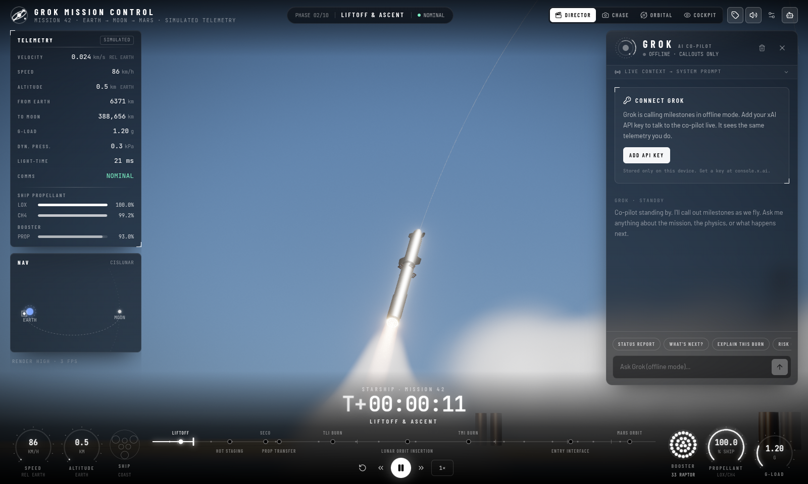
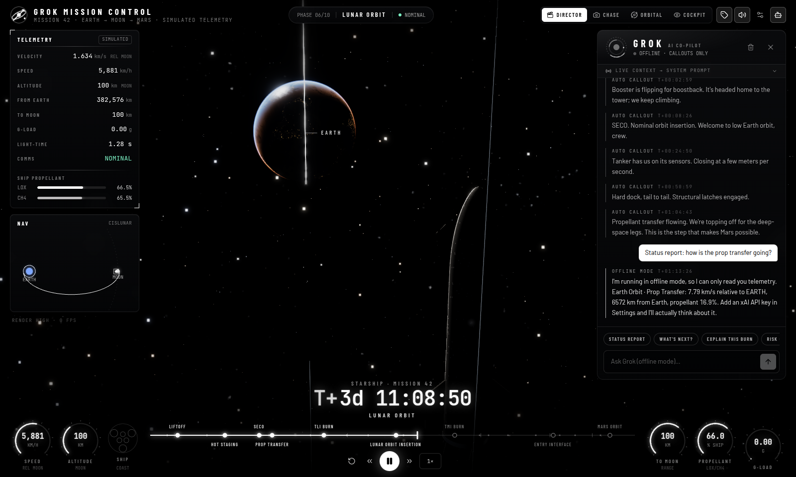
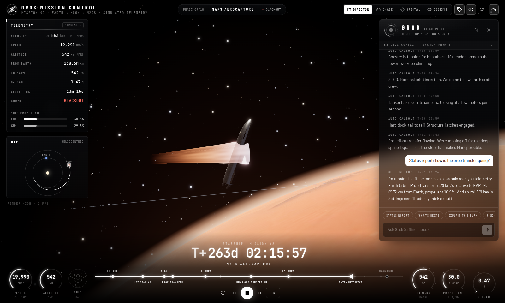

# Grok Mission Control

Grok Bot Hackathon Boston 10/09/2026

A cinematic mission-control desktop app for a crewed Starship-class flight from **Earth to the Moon to Mars**, with **Grok** riding along as your AI co-pilot. Built for the grokbot Hackathon in Boston.





## Downloads

Installers for macOS (Apple silicon and Intel), Windows, and Linux, plus a Chrome/browser build, are published from the tag on the [releases page](https://github.com/AaronGrace978/Grok-Mission-Control/releases).

The browser zip is the Vite production build. Unzip it and serve the folder (`npx serve .`) so Chrome can load it. Live Grok replies in the browser need the dev proxy (`npm run dev`) or the desktop app, which calls the xAI API from Rust.

- **Real-time 3D:** Three.js / react-three-fiber with HDR bloom, ACES tone mapping, and a lens flare.
  - Textured Earth with clouds, night lights, ocean glint, and an atmosphere.
  - The Moon, Mars, the Sun, and a Milky Way skybox.
- **Procedural vehicles:**
  - A Starship-style ship and a 33-engine booster.
  - Hot staging, booster boostback, and an orbital tanker for propellant transfer.
  - A launch tower with deluge steam.
  - GPU exhaust plumes with shock diamonds, plus Mars aerocapture plasma.
- **The full mission:** terminal count, liftoff, max-Q, hot staging, LEO prop transfer, TLI, translunar coast, far-side lunar orbit insertion (with loss of signal and Earthrise), TMI, a 259-day Hohmann cruise, belly-first Mars aerocapture, and Mars orbit.
- **Webcast-style HUD:**
  - A big T+ clock, speed and altitude gauges, and live engine-cluster diagrams.
  - A milestone scrubber with play/pause and 0.5x–8x speed.
  - Telemetry, a cislunar-to-heliocentric nav map, and milestone toasts.
  - All telemetry comes from real physics and is labeled **simulated**: ascent profile, vis-viva, the Moon's sphere of influence, a heliocentric Hohmann transfer, light-time, g-load, and dynamic pressure.
- **Camera views:**
  - Director (an auto-cut cinematic schedule), Chase, Orbital overview, and Cockpit.
  - Drag to orbit, scroll to zoom.
- **Grok co-pilot:**
  - Streams from the xAI API. Every request carries a system prompt built from the live phase and telemetry.
  - Calls out milestones even without an API key.
- **Polish:** boot sequence with a GO/NO-GO poll, procedural ambient audio (cabin drone, throttle-driven engine rumble, chimes), auto quality scaling (Low/Medium/High/Ultra), and a responsive layout.

## Quick start (browser)

```bash
npm install
npm run dev
```

Open http://127.0.0.1:1420 and click **Enter Mission Control**.

## Desktop app (Tauri v2)

```bash
npm run tauri dev     # native window with hot reload
npm run tauri build   # release bundles in src-tauri/target/release/bundle/
```

Requirements:

- Rust stable (1.85 or newer). Run `rustup update stable` if needed.
- The [Tauri prerequisites](https://v2.tauri.app/start/prerequisites/) for your OS. On Debian/Ubuntu:

```bash
sudo apt install libwebkit2gtk-4.1-dev build-essential curl wget file libxdo-dev libssl-dev libayatana-appindicator3-dev librsvg2-dev
```

## Connecting Grok (xAI API key)

1. Create a key at [console.x.ai](https://console.x.ai).
2. In the app, open **Settings** (gear icon) and go to the **Grok** tab. Paste the key, then click **Test connection** and **Save**.
3. Talk to Grok in the right-hand panel. The quick chips (Status report, What's next?, ...) are one-click prompts.

Where the key goes:

- **The key is never hardcoded or committed.** It is stored only on your device:
  - Desktop: the Tauri store plugin (`settings.json` in the app data directory).
  - Browser: `localStorage`.
- **Desktop requests** go from the native Rust backend (`src-tauri/src/lib.rs`, the `grok_stream` command), which streams tokens back over a Tauri channel. The webview never needs CORS access to `api.x.ai`.
- **Browser requests** go through the Vite dev/preview proxy (`/api/xai` → `https://api.x.ai`). A static `dist/` deploy has no proxy, so use `npm run dev`, `npm run preview`, or the desktop app.

**Model and API.** The default model is `grok-4.7`. Settings also offers other presets or any custom model id. The API setting **Auto** tries Chat Completions (`/v1/chat/completions`, streaming) first. If the model or endpoint rejects that before any text arrives, it falls back to the Responses API (`/v1/responses`). You can force either one.

**Without a key**, Grok runs in offline mode. It still narrates every milestone and answers with a telemetry readout.

## Controls

| Key | Action |
| --- | --- |
| `Space` | Play / pause |
| `←` `→` | Previous / next major milestone |
| `1`–`4` | Director, Chase, Orbital, Cockpit camera |
| `G` | Toggle the Grok panel |
| Drag / scroll | Orbit / zoom the camera (switches Director to Chase) |

## Performance

The target is 60 fps on RTX 4060-class GPUs at **High**. **Ultra** adds 4x MSAA, more stars, more particles, and denser spheres. **Auto** (the default) watches the frame rate, steps between Low, Medium, and High, and remembers any manual choice. Low turns off post-processing and uses 2k textures.

## Architecture

```
src/
  sim/        mission model: timeline + events, trajectory geometry, heliocentric Hohmann model,
              per-frame telemetry (frame.ts), and a mutable clock singleton (no React re-renders per frame)
  scene/      r3f scene: bodies + shaders, vehicles (ship, booster, tanker, launch site, plumes),
              trajectory, director camera rig, post-processing, screen-space overlay probe
  hud/        webcast HUD: top bar, telemetry, nav map, gauges + timeline, toasts, labels + lens flare
  grok/       co-pilot panel, chat store, system prompt + offline callouts
  lib/        xAI streaming client (SSE, chat → responses fallback), audio, formatting
src-tauri/    Rust backend: streaming grok_stream / grok_cancel commands, store plugin
```

- The scene uses a logarithmic depth buffer and a dynamic near plane. That lets a 50 m ship and a 3,390 km planet render in the same frame without z-fighting.
- Planet distances are compressed for the camera, but the numbers in the HUD come from real orbital mechanics in kilometres.

## Credits and licenses

- Planet, Moon, Sun, and Milky Way textures: [Solar System Scope](https://www.solarsystemscope.com/textures/), based on NASA imagery, licensed [CC BY 4.0](https://creativecommons.org/licenses/by/4.0/). The files are in `public/textures/`.
- Vehicles, launch site, plumes, HUD, the mission emblem, and the Grok core mark are procedural or original to this project. No official logos or trademarked artwork are used.
- Fonts: Barlow, Barlow Condensed, and JetBrains Mono (SIL Open Font License) via Fontsource.

Fan-made hackathon project. Not affiliated with or endorsed by SpaceX or xAI. All telemetry is simulated.
